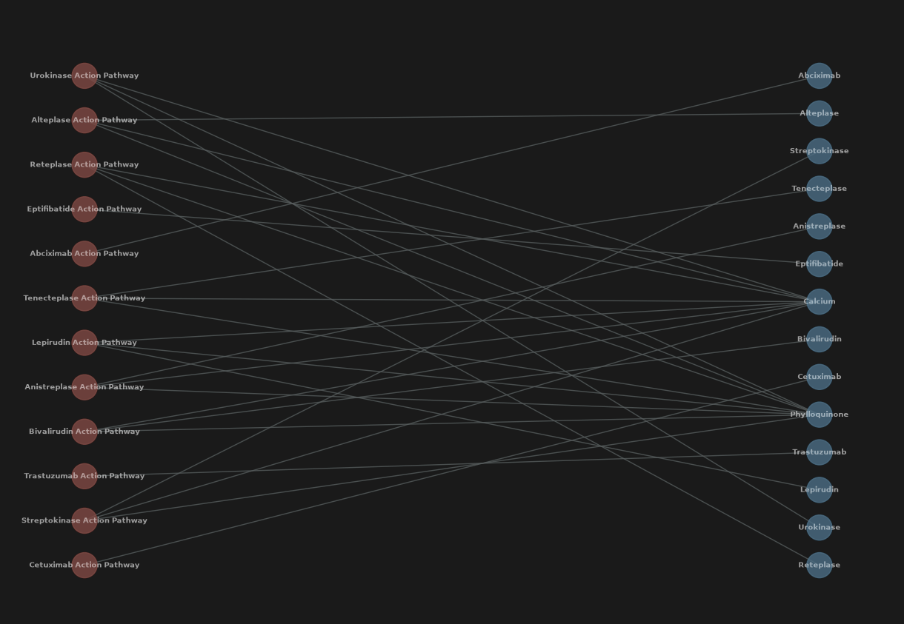

# Pharmacological Network Analytics and EDA


## 1. Abstract & Objective

This project implements an automated pipeline for extracting, transforming, and analyzing (ETL) data from the hierarchical DrugBank biomedical database. The primary objective is to transform complex nested XML records into structured relational formats for subsequent graph modeling and exploratory data analysis (EDA). 

The project uncovers hidden biological relationships between target genes, active ingredients, and commercial products, while providing a REST API to seamlessly integrate analytical functions into external services.

## 2. System Architecture & Data Pipeline

The pipeline consists of three primary modules executing sequentially:

### 2.1 Memory-Efficient XML Extraction (ETL)
To process massive XML dumps, the system utilizes the `lxml` library and its event-driven `iterparse` method. This streaming approach prevents Out-Of-Memory (OOM) errors when handling multi-gigabyte files. The parser dynamically extracts target nodes (synonyms, pharmaceutical products, target proteins, biological pathways) and clears the element tree immediately after processing each record, ensuring a strictly bounded memory footprint.

### 2.2 Network Modeling & EDA
Structured data is converted into DataFrames using `pandas`. The visualization module employs `NetworkX` to construct programmatic graph representations:
-   **Bipartite Graphs:** Displaying interactions between metabolic pathways and pharmaceutical drugs.
-   **Hierarchical Directed Networks:** Mapping the biological and market flow: `Target Gene` $\rightarrow$ `Active Ingredient` $\rightarrow$ `Market Product`.

Aggregated statistics (e.g., pipeline approval statuses, cellular localization distributions) are visualized via interactive `Plotly` charts.

### 2.3 REST API Layer
The business logic is wrapped in a high-performance asynchronous server using `FastAPI`. The server loads the extracted biological pathways into RAM upon startup and exposes endpoints for retrieving quantitative data regarding drug-pathway interactions in real-time.

## 3. Visualizations

Complex graph analysis allows for the precise localization of target proteins and the identification of key nodes in pharmacological pathways. The generated bipartite networks cleanly isolate drug interactions prior to further downstream analysis.



## 4. Testing & Validation

The system architecture prioritizes data integrity and code reliability:
-   **Unit Testing:** The extraction pipeline is covered by `pytest`. Temporary fixtures containing dummy XML data isolate the testing environment, guaranteeing the correctness of the extraction algorithms independently of the full DrugBank dataset.
-   **API Validation:** The FastAPI server strictly validates incoming POST requests via Pydantic schemas, returning accurate aggregated interaction counts with a `200 OK` status and raising appropriate HTTP exceptions for unmapped entities.

## 5. Quick Start

This project uses `uv` for lightning-fast and reproducible environment management.

```bash
# Clone the repository and sync dependencies
git clone https://github.com/Pavelpuff/pharma-network-analytics.git
cd pharma-network-analytics
uv sync

# 1. Run the mock database generator (creates 20,000 synthetic records)
uv run python -m src.xml_simulator

# 2. Execute extraction unit tests
uv run pytest tests/ -v

# 3. Launch the REST API server
uv run uvicorn src.api:app --reload
```